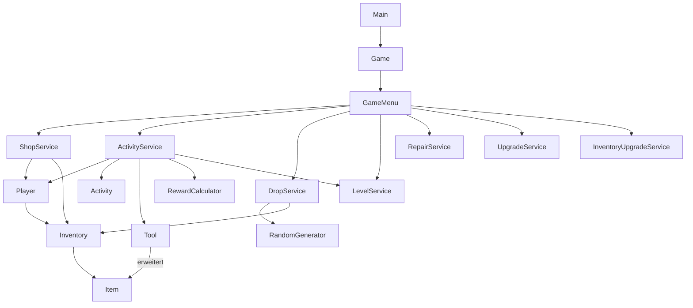

# Architektur

Die Konsolenschicht verarbeitet Eingaben und stellt Ergebnisse dar. Die
Geschäftsregeln befinden sich in kleinen Services und Domänenklassen. Dadurch
können sie ohne echte Konsole getestet werden.

## Verantwortlichkeiten

| Bereich | Verantwortung |
|---|---|
| `game` | Konsolenablauf und Dependency Wiring |
| `player` | Geld, XP, Level und Levelgrenzen |
| `inventory` | Items und Kapazitätsregeln |
| `item` | Items, Werkzeuge, Schaden und Haltbarkeit |
| `shop` | Käufe, Verkäufe, Reparaturen und Inventar-Upgrades |
| `activity` | HP, Angriffe, Freischaltungen und Belohnungsvergabe |
| `economy` | Berechnung von Goldbelohnungen |
| `random` | abstrahierter Zufall und Drop-Verteilung |

`RandomGenerator` ist eine injizierbare Abhängigkeit. Im Spiel wird
`JavaRandomGenerator` verwendet, während Tests ein Mockito-Mock oder eine feste
Lambda-Funktion einsetzen.
